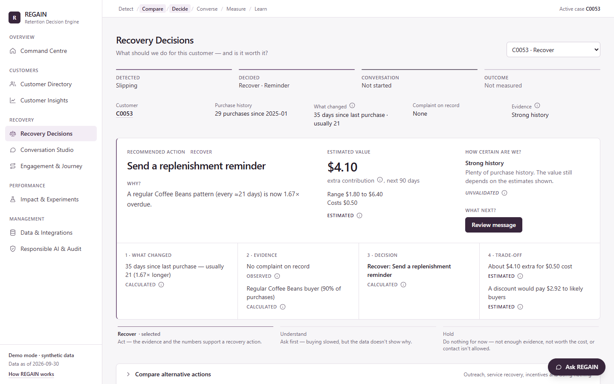
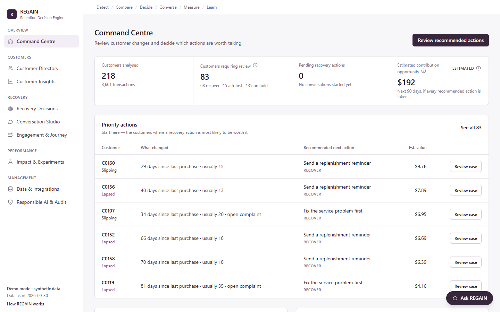
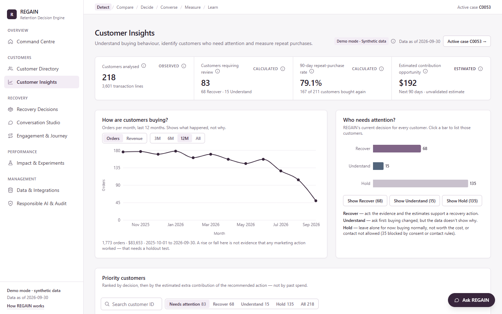
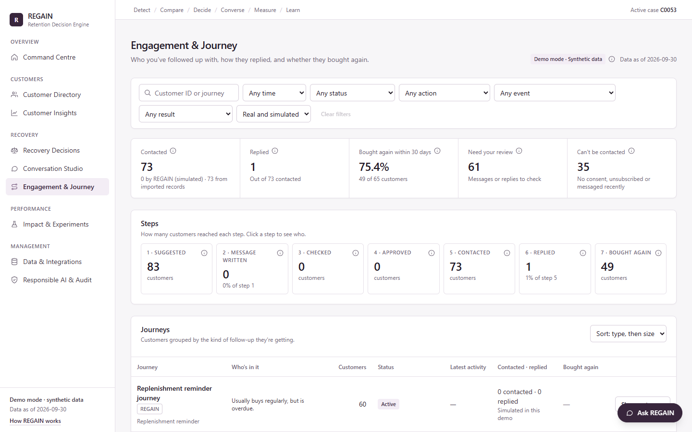

# REGAIN — The Retention Decision Engine

**Recover the right customer. Choose the right action. Prove it was worth it.**

AI-GNITION 2026 prototype for **Eslitec Problem Statement 1**: *How might businesses turn existing customer data into personalised, automated conversations that measurably increase retention and repeat purchases?*

**Live demo:** https://regain-ai.vercel.app — opens straight into a synthetic demo dataset; no sign-in or setup.

> **Demo data is synthetic.** The default dataset is 218 fictional customers of a fictional coffee roaster, generated by `src/lib/sampleData.ts`. **No real message is ever sent** — sends and customer replies are simulated and labelled as such. AI features are **optional** and off by default; everything works without an API key.



---

## 1. The problem

Small businesses can see that customers are buying less often, but not *why* — so they send generic messages and blanket discounts. Many of those discounts pay for purchases that would have happened anyway, and few businesses ever measure whether the message made a difference.

## 2. What REGAIN does

REGAIN reads a business's existing transaction export and, for every customer, works through one explainable workflow:

```
DETECT → COMPARE → DECIDE → CONVERSE → MEASURE → LEARN
```

- **Detect** — compares each customer with **their own** usual gap between purchases (robust median statistics), not a store-wide average.
- **Compare — the Recovery Trial** (the core idea): before recommending anything, REGAIN compares six options side by side — helpful check-in, replenishment reminder, service recovery, non-monetary thank-you, discount, and **doing nothing** — on estimated extra contribution (margin, not revenue), cost, uncertainty, eligibility and the reason each alternative was rejected. Discounts are charged for the buyers who would have returned anyway ("discount leakage").
- **Decide** — **Recover** (act), **Understand** (ask first — the cause isn't evidenced) or **Hold** (do nothing, or contact isn't allowed).
- **Converse** — drafts a fact-checked message that a person must review and approve; consent, opt-outs and contact limits are hard rules.
- **Measure & learn** — compares customers who did and didn't receive the action (randomised holdout, confidence intervals) and can update the estimates from a measured result.

### Features at a glance

| Page | What it's for |
|---|---|
| **Command Centre** | Who needs attention today, priority actions, demo cases |
| **Customer Directory / Customer Insights** | Search customers; portfolio dashboard (trend, decisions, priority list, repeat-purchase rate); per-customer profile with plain-English "What this means" and evidence |
| **Recovery Decisions** | The Recovery Trial for one customer: recommendation, why, value, certainty, alternatives, live what-if estimates |
| **Conversation Studio** | Draft → claims check → human approval → simulated send → simulated reply |
| **Engagement & Journey** | Who was followed up, how they replied, whether they bought again; timeline per customer |
| **Impact & Experiments** | Holdout experiments, past-campaign analysis, honest uncertainty, update estimates from results |
| **Data & Integrations** | CSV upload with validation and personal-data removal, editable estimates, contact limits, demo reset |
| **Responsible AI & Audit** | Who can be contacted, safety rules, activity log with CSV export |
| **Ask REGAIN** (every page) | Decision Copilot: explains decisions, compares actions, runs what-ifs — answers come from REGAIN's own engine |

<details>
<summary>More screenshots</summary>





</details>

## 3. Run it locally

**Requirements:** Node.js 20 or newer (developed on Node 24.16 / npm 11.13).

```bash
git clone <this repository>
cd <repository folder>
npm install
npm run dev            # open http://localhost:3000 — the synthetic demo data loads automatically
```

No environment variables are needed. To try the **optional** AI features, copy `.env.example` to `.env.local` (git-ignored), add your own Anthropic key, and restart `npm run dev`. Never commit `.env.local`.

| Command | What it does |
|---|---|
| `npm run dev` | Development server on http://localhost:3000 |
| `npm run build` then `npm start` | Production build and server |
| `npm run typecheck` | TypeScript check |
| `npm test` | 151 unit tests (Vitest) |
| `npm run e2e` | 89 browser checks in headless Chrome/Edge. Start the app first; set `BASE_URL` if it isn't on port 3000 and `BROWSER_PATH` if your browser isn't found automatically |
| `npm run sample` | Re-generates the synthetic CSVs in `public/samples/` |

Sample files to try the upload flow: `public/samples/regain_sample_transactions.csv`, `regain_sample_interventions.csv`, and `regain_messy_sample.csv` (deliberately messy — invalid dates, duplicates, and email/gender columns that REGAIN discards; all emails use the reserved `example.com` domain).

### Deploy your own copy (optional)

Import the repository into Vercel (framework preset **Next.js**, default settings). No environment variables are required. Optionally add `ANTHROPIC_API_KEY` (and `ANTHROPIC_MODEL`) under **Settings → Environment Variables**; the key is read only by the server routes `/api/generate-message` and `/api/copilot` and never reaches the browser.

## 4. Technology

- **Next.js 15 (App Router), React 19, TypeScript**, Tailwind CSS 3, Recharts 2, Papa Parse 5.
- **No database:** state is a reducer persisted to the browser's `localStorage` (validated on load). Uploaded data stays on the user's machine.
- **Optional server routes:** Anthropic Messages API for message drafting and Copilot rewording — both fall back to deterministic output when no key is set, and AI output is validated before use.
- **Testing:** Vitest (unit), puppeteer-core with a locally installed Chrome/Edge (browser tests).

## 5. Why REGAIN is different from a churn dashboard

| Generic churn dashboard | REGAIN |
|---|---|
| Scores "churn risk" against store-wide averages | Compares each customer with **their own** median purchase gap, using robust statistics (median, MAD) |
| Says *who* is at risk | Decides *what to do* — including **nothing** — and why |
| Defaults to a discount blast | Ranks 6 actions on **contribution**, charging discounts for the buyers who would have returned anyway ("discount leakage") |
| Treats inactivity as dissatisfaction | Separates **facts / indicators / hypotheses / unknowns**; asks (UNDERSTAND) when the cause isn't evidenced |
| Reports "customers who came back" | Measures **incremental** effect against a random holdout, with confidence intervals and small-sample warnings |
| Opaque ML score | Every number is a visible formula with editable assumptions; nothing is presented as a validated probability |

## 6. Architecture

```
src/
  lib/                     Pure, framework-free domain logic (unit-tested)
    csv.ts                 Parsing (Papa Parse), column auto-mapping, validation, duplicates,
                           missing values, sensitive/PII column exclusion, sanitisation
    behaviour.ts           Orders, intervals, robust rhythm, status, trends, evidence layers
    policy.ts              Consent, opt-out, decline suppression, frequency caps (hard rules)
    trial.ts               Recovery Trial: scenario economics, eligibility, ranking, decisions
    conversation.ts        Deterministic drafting, claims guard, conversation state machine
    experiment.ts          Hash assignment, outcomes, Wilson/Newcombe CIs, z-test, power
    insights.ts            Customer Insights metrics: trend, repeat rate, AOV, priority order,
                           contact eligibility, "What this means"
    journey.ts             Engagement & Journey: typed events derived from existing records,
                           steps, journeys, filters, KPIs and outcomes (read-only)
    copilot.ts             Decision Copilot: deterministic, allowlisted answers built on the engine
    copilotGuard.ts        Redaction of facts sent to a model + validation of model output
    sampleData.ts          Seeded synthetic dataset (fictional coffee roaster)
    store.ts               App state reducer + audit trail
    analysis.ts            Derives all profiles and decisions from state
    present.ts             Plain-language labels for engine output (wording only, no logic)
  components/              AppProvider (state + localStorage), Shell (sidebar, workflow bar, active
                           case), ui.tsx (design system and Observed/Calculated/Estimated/Simulated
                           labels), CustomerProfile, InsightsOverview, Copilot ("Ask REGAIN" panel),
                           CaseBar, Onboarding, AssumptionsForm, chartTheme
  app/
    page.tsx               Command Centre
    customers/             Customer Directory and direct customer links ([id])
    insights/              Customer Insights: overview (/insights) and profile (/insights?id=…)
    trial/                 Recovery Decisions — the Recovery Trial
    studio/                Conversation Studio
    journeys/              Engagement & Journey (read-only monitor)
    impact/                Impact & Experiments
    data/                  Data & Integrations
    responsible/           Responsible AI & Audit
    api/generate-message/  OPTIONAL server-side AI drafting with template fallback
    api/copilot/           OPTIONAL server-side AI rewording of Copilot answers (validated)
tests/                     Vitest unit tests
scripts/                   e2e.mjs (browser test), generate-sample.ts
public/samples/            Synthetic demo CSVs
docs/                      PITCH.md (demo script), screenshots/
```

* The synthetic sample is emitted as CSV text and passed through **the same validation pipeline as an upload**.
* All decisions are recomputed (memoised) from state whenever data, assumptions, contacts or suppressions change.

## 7. Formulas

### Behaviour (per customer, as of the analysis date)
* **Orders**: lines grouped by order ID (or customer + date). Same-day orders count as one visit for rhythm.
* **Intervals**: days between consecutive purchase dates. **Usual gap** = median interval.
* **Rhythm source**: ≥2 intervals → *personal*; 1 → *provisional*; 0 → *insufficient history* (store-wide median shown as context only).
* **Overdue ratio** = days since last order ÷ usual gap. Status: <1.25 on rhythm · <2 slipping · <4 lapsed · ≥4 dormant.
* **Robust z** = (current gap − median) ÷ max(1.4826·MAD, 0.2·median, 3 days).
* **Variability** (CV) = 1.4826·MAD ÷ median.
* **Typical order value** = median (outliers > median + 3·robust scale are flagged and ignored).
* **Spend trend** = (last 182 days − previous 182 days) ÷ previous.
* **Evidence score** (data sufficiency, not a probability) = min(orders,8)/8×0.5 + regularity (0.3/0.2/0.1) + category present 0.1 + consent recorded 0.1.

### Recovery Trial (per action *a*, 90-day horizon by default)
```
p0  = baseline purchase probability for the customer's status   (heuristic, editable)
u_a = assumed uplift × status responsiveness × evidence-fit adjustments
p_a = min(0.95, p0 + u_a)
N   = clamp(horizon ÷ usual gap, 1, 3)        (1 without a personal rhythm)

Revenue_a        = p_a × N × AOV
Contribution_a   = Revenue_a × margin
Costs_a          = contact + p_a × benefit + p_a × discount% × AOV + optOutRisk_a × optOutLoss
Incremental_a    = (Contribution_a − Costs_a) − p0 × N × AOV × margin
                 = u_a × N × AOV × margin − Costs_a
Discount leakage = p0 × discount% × AOV   (discount paid to customers who would buy anyway)
Range            = Incremental at uplift × (1 ± band); band = 50% / 75% / 100% for high / medium / low
                   evidence, +25% without a personal rhythm
```
Adjustments (documented in code): status responsiveness (on rhythm ×0.3, slipping ×1, lapsed ×0.8, dormant ×0.4); reminder ×0.35 without a regular, category-concentrated pattern; with an unresolved service issue, promotional actions ×0.5 uplift and ×3 opt-out risk.

### Decision rule
1. **Hard policy** — opted out, no/unknown consent, declined within 90 days, or frequency cap → **HOLD**.
2. **Evidence** — one-order customers → **HOLD** (insufficient history / too early); on rhythm → **HOLD**.
3. **Cause unclear** (no recorded issue and no regular replenishment pattern) → **UNDERSTAND** with a low-pressure check-in if its expected incremental contribution ≥ 0, else **HOLD**.
4. **Cause evidenced** → best eligible action (service recovery first when an issue is open and it is not loss-making). If it clears the minimum threshold → **RECOVER**, else **HOLD**.

### Impact & Experiments
* Assignment: `control if FNV1a(seed :: customerId) / 2³² < holdout share` — reproducible.
* Rates with **Wilson** 95% intervals; difference with **Newcombe** hybrid interval; pooled two-proportion z-test.
* Incremental purchases = (rate_T − rate_C) × treated observed; incremental revenue = (revenue/treated − revenue/control) × treated observed; contribution = incremental revenue × margin − contact/benefit costs − discounts paid.
* Sample size per arm = (1.96 + 0.84)² × [p1(1−p1) + p2(1−p2)] ÷ (p1 − p2)².
* Pending outcomes (window open / unrecorded) are excluded and **never** counted as recoveries.

## 8. Implemented vs simulated

| Capability | Status |
|---|---|
| CSV upload, mapping, preview, validation, duplicates, missing values, PII/sensitive column exclusion | **Implemented** |
| Synthetic dataset, one-click load, CSV downloads, reset, clear | **Implemented** (data is synthetic) |
| Behavioural metrics, evidence layers, limitations, timelines | **Implemented** |
| Customer Insights overview: orders/revenue trend, Recover/Understand/Hold breakdown, priority table with contact eligibility, 90-day repeat-purchase rate, average order value | **Implemented** (Calculated from the loaded records) |
| Engagement & Journey monitor: steps, journeys, customer activity, timeline, outcomes after contact | **Implemented**, read-only and derived from existing records. Sends and replies **Simulated**; recurring automations **Planned**, not built |
| Customer lifetime-value forecast | **Planned** — not built; it would need validated retention and margin assumptions |
| Recovery Trial economics, ranking, RECOVER/UNDERSTAND/HOLD, rejected-alternative reasons | **Implemented** (uplifts and baselines are *estimates*) |
| Interactive what-if simulator, apply assumptions globally | **Implemented** |
| Consent / opt-out / decline suppression, frequency caps | **Implemented** |
| Deterministic message drafting, claims guard, edit/approve/reject, review gate | **Implemented** |
| Sending messages | **Simulated** — nothing is sent; approved sends are recorded as contacts |
| Customer replies | **Simulated** (4 scripted responses drive a real state machine) |
| External AI drafting | **Implemented but optional and untested against the live API** (no key was available). Without a key the route returns the template — this path is tested. AI output is claims-checked and falls back to the template if it fails |
| Holdout assignment, manual outcome recording, measurement from transactions, metrics + CIs | **Implemented** |
| Experiment outcomes for new experiments in the demo | **Simulated** on request (seeded, labelled, cannot calibrate assumptions) — future purchases do not exist in the demo data |
| Historical campaign analysis + LEARN calibration | **Implemented**, run on the synthetic May-26 campaign embedded in the sample |
| Audit trail + CSV export | **Implemented** |
| Decision Copilot ("Ask REGAIN"): explain decisions, compare actions and run what-ifs, portfolio search, experiment interpretation | **Implemented**, deterministic. Every figure comes from REGAIN's engine. What-ifs never change saved data; saving one needs a two-step confirmation and is audited. Requests to bypass consent or limits are refused. It cannot approve or send |
| Decision Copilot AI rewording | **Implemented but optional and untested against the live API.** Opt-in; sends only redacted fact sentences (no IDs, records or CSV); replies are validated on the server and in the browser. Tested with mocked provider responses only |
| Persistence | Browser `localStorage` only (no multi-user backend) |

## 9. Testing

Last full run: 2026-10-22 (Windows 11, Node 24.16).

* `npm run typecheck` — passes.
* `npm test` — **151 / 151 passed** across 9 files: CSV validation & import (11); interval and sparse-data calculations (14); decision ranking, scenario arithmetic, no-action, consent & frequency caps (20); conversation drafting & state transitions (12); assignment, statistics & impact metrics (11); reset & state (8); Decision Copilot (34); Customer Insights metrics (20); Engagement & Journey (21).
* `npm run build` — production build succeeds (all pages and both API routes compile and type-check).
* `npm run e2e` — **89 / 89 checks passed** in headless Edge against the production build, including 14 Copilot, 19 Customer Insights and 13 Engagement & Journey checks, consent blocking, CSV import, experiments, the audit trail and phone-width layout. See REGAIN_PRESENTATION_BRIEF.md §8 for coverage.
* **Not tested:** the live Anthropic API, for both optional AI paths (no key was available); they are tested with mocked responses only.
* Layout checked at 1280 px, 1440 px and 390 px. Text contrast (WCAG) on white: primary 17:1, body 11.6:1, secondary 5.4:1, crimson text 6.0:1, green 5.2:1, white on the primary button 13.9:1.

## 10. Responsible AI, privacy and security

See the in-app **Responsible AI & Audit** page. In short: synthetic data by default; consent required (missing = no); opt-outs, declines and frequency caps are hard rules; human review gate before any (simulated) send; claims guard against unsupported statements; sensitive attributes and direct identifiers discarded at import; `{first_name}` placeholder instead of storing names; untrusted input sanitised and size-capped; formula-injection-safe exports; no secrets in the frontend; full audit trail; heuristics labelled as estimates; simulations labelled and excluded from learning.

**Decision Copilot data use:** by default nothing leaves the browser. With a server key and the opt-in checkbox, the external model receives only the answer's derived fact sentences (at most 24 × 280 characters), with customer IDs replaced by "Customer A", "Customer B" and quoted record text removed. Raw transactions, CSV content, consent fields and other customers are never sent. Model output that adds numbers, claims proof, infers feelings or drops a *simulated* label is discarded.

**Security notes and known issues**
* No secrets are stored in this repository. `.env*` files are git-ignored except `.env.example`, which contains empty placeholders only.
* The optional API key is read only in server routes and is never returned to the browser (the routes report only whether a key is configured).
* Data is stored in the browser's `localStorage` without encryption — fine for the demo, not for real customer data on a shared computer. There is no login or multi-user access control.
* `npm audit` reports advisories in the PostCSS copy bundled inside Next.js 15 (build-time CSS processing of the project's own stylesheet). The fix requires upgrading to Next.js 16, a breaking change not made for this prototype.
* The repository has not been through a professional security review.

**Disclosure.** Libraries: Next.js, React, Tailwind CSS, Recharts, Papa Parse, Vitest, tsx, puppeteer-core (dev only) — open-source (MIT / Apache-2.0). Optional external AI: Anthropic Messages API, only when a key is configured server-side. Dataset: generated by this project (`src/lib/sampleData.ts`). No third-party images, fonts or datasets are used. The prototype was built with the help of an AI coding assistant (Claude Code).

## 11. Limitations

* Baselines and uplifts are configurable heuristics, not trained or validated models; the app says so wherever they appear.
* The data cannot see purchases elsewhere: "lapsed" may mean a competitor or no remaining need.
* Only the latest open service issue is considered; severity isn't modelled. Refunds are rejected at import, not netted.
* The embedded historical test is synthetic; its "true" effect was injected by the generator (≈ +12 pp among treated non-buyers) and the measured result (+9.5 pp, 95% CI −5.5 to +23.9 pp, n = 70/71) correctly shows it is **not** statistically conclusive at that size.
* Calibration uses the observed difference as-is even when the outcome window (30 days) differs from the decision horizon (90 days); the UI warns about this.
* Messaging and replies are simulated; there is no email/SMS/WhatsApp integration, so deliveries, opens and real replies can't be measured.
* Browser storage only: no multi-user access, no server-side records. The Engagement & Journey history is rebuilt from the activity log, which keeps the latest 500 entries.
* No claim is made that REGAIN has improved real-world retention — it has only been run on synthetic data.

## 12. Hackathon materials

* **[REGAIN_PRODUCT_GUIDE.md](REGAIN_PRODUCT_GUIDE.md)** — how every page, calculation and safeguard works, with worked examples and judges' Q&A.
* **[REGAIN_PRESENTATION_BRIEF.md](REGAIN_PRESENTATION_BRIEF.md)** — the factual source of truth for the pitch deck.
* **[docs/PITCH.md](docs/PITCH.md)** — seven-minute demo script, 150-word summary and one-page solution brief outline.

## Licence

No licence has been chosen yet: © 2026 the REGAIN team, all rights reserved. You're welcome to read, run and evaluate the code for judging; please ask before reusing it.
